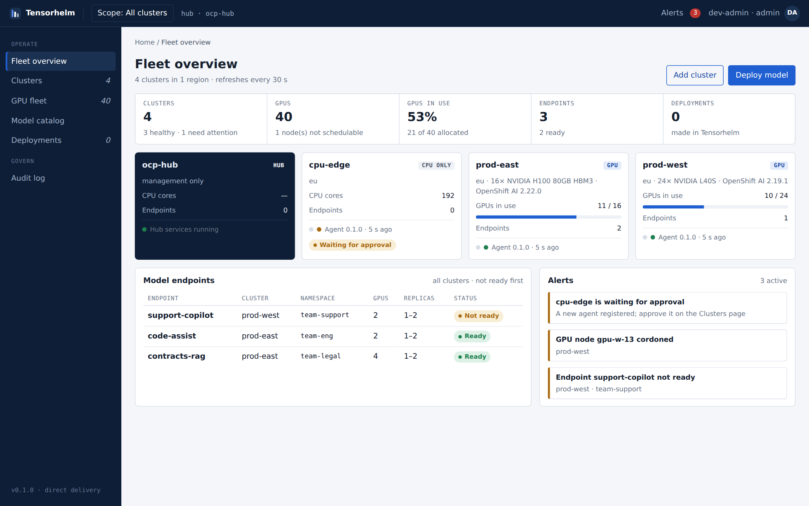

# Tensorhelm

One central portal to run large language models across OpenShift clusters, with or without GPUs.
Tensorhelm finds every GPU in your fleet, checks whether a model fits before anyone deploys it, and
deploys it on Red Hat OpenShift AI with vLLM. Delivery is either direct to the hub cluster, or through
GitLab and Argo CD to any cluster.



## What it does today

| Area | What works |
| --- | --- |
| Sign-in | OpenShift login through the oauth-proxy. Three roles, mapped from OpenShift groups: admin, engineer, viewer. |
| Fleet overview | Clusters, GPUs in use, model endpoints and alerts across all clusters. |
| Clusters | RHACM managed clusters appear automatically. A lightweight agent on each cluster reports GPUs, endpoints and serving runtimes over an outbound connection. New agents wait for admin approval. |
| GPU fleet | Every GPU node from NVIDIA GPU Operator labels: model, memory, driver, CUDA, MIG, usage. No manual entry. |
| Model catalog | Starter catalog, Hugging Face search, OpenShift AI Model Registry, OpenRouter (listed as external). |
| Fit check and placement | Estimates GPU memory for a model at a given precision, context and concurrency. Picks the smallest tensor-parallel size, then ranks every cluster and explains why the others cannot run it. |
| Deploy | Renders a vLLM ServingRuntime and a KServe InferenceService (RawDeployment). Applies them to the hub, or commits them to GitLab for Argo CD to sync. |
| Audit log | Every approval, deployment and removal, with who did it. |

Planned next: quotas and token budgets per team, playground, cost and chargeback, promotion gates, and canary releases.
These are designed in the [product concept](https://claude.ai/artifact/HExV3358VQw9kZTpVJ3fvY).

## Install on OpenShift

You need:
- OpenShift 4.14 or later, logged in with `oc` as cluster-admin
- Red Hat OpenShift AI and the NVIDIA GPU Operator, on the clusters that serve models

You may also have RHACM and OpenShift GitOps; Tensorhelm uses them when they are present.

```bash
git clone https://github.com/cskaruppu/llmdepobs.git && cd llmdepobs
./scripts/install.sh --admin-user <your-openshift-user>
```

The script builds the images inside the cluster, creates the database, the API and the portal, and prints
the portal URL. Re-run it to upgrade.

For multi-cluster delivery through GitLab and Argo CD:

```bash
export GITLAB_TOKEN=glpat-...            # api scope, Developer on the project
./scripts/install.sh --admin-user <you> --delivery gitops \
  --gitlab-url https://gitlab.example.com --gitlab-project platform/tensorhelm-gitops
```

Full instructions: [docs/INSTALL.md](docs/INSTALL.md).

## Add a remote cluster

```bash
oc login <hub-api>   && oc config rename-context "$(oc config current-context)" hub
oc login <spoke-api> && oc config rename-context "$(oc config current-context)" prod-east
oc config use-context hub
./scripts/register-cluster.sh --name prod-east --spoke-context prod-east \
  --label region=eu --label tensorhelm.io/role=serving --approve
```

This imports the cluster into RHACM (if RHACM is installed) and labels it. It then builds and starts the
agent on the cluster, waits for it to register, and approves it.

Other ways to add or discover clusters, and the network rules: [docs/CLUSTERS.md](docs/CLUSTERS.md).

## Repository layout

```
services/api/      Python 3.12 FastAPI hub API and spoke agent (one image, two commands)
services/web/      React + TypeScript portal, served by nginx behind the OpenShift oauth-proxy
deploy/openshift/  OpenShift Templates: hub, agent, in-cluster image builds
deploy/gitops/     Argo CD wiring: RHACM ApplicationSet, or a single Application without RHACM
scripts/           install.sh, register-cluster.sh, unregister-cluster.sh, uninstall.sh
docs/              Install, clusters, operations and architecture guides
```

## Develop locally

```bash
cd services/api && python -m venv .venv && . .venv/bin/activate && pip install -e '.[dev]'
pytest                                   # 31 tests, no cluster needed
TH_AUTH_MODE=dev TH_KUBE_ENABLED=false TH_AGENT_BOOTSTRAP_TOKEN=dev-boot tensorhelm-api &
python scripts/dev_seed.py               # three example clusters

cd ../web && npm install && npm run dev  # http://localhost:5173, proxies /api to :8000
```

To run against a real cluster from your laptop, log in with `oc` and leave out `TH_KUBE_ENABLED=false`.
The API then inventories that cluster as the hub.

## Documentation

- [Install and upgrade](docs/INSTALL.md)
- [Adding and discovering clusters](docs/CLUSTERS.md)
- [Operating Tensorhelm](docs/OPERATIONS.md)
- [Architecture and security](docs/ARCHITECTURE.md)
